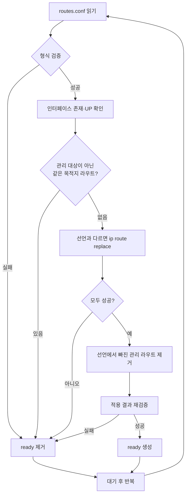

# multi-nic-route-reconciler

AKS처럼 노드에 Secondary NIC이 여러 개 붙은 Kubernetes 환경에서, **트래픽 종류별 노드 라우팅을 선언적으로 관리**하는 DaemonSet입니다.

ConfigMap에 "어느 대역을 어느 NIC으로 보낼지"를 적어두면, 각 노드의 라우팅 테이블을 그 상태로 맞추고 계속 유지합니다.

## 배경

DR 환경을 구성하면서 서비스, DB, 파일 전송, 백업 트래픽을 서로 다른 서브넷과 NIC으로 분리해야 했습니다. 목적은 대역폭 확보가 아니라 **경로와 서브넷을 분리해 용도별로 보안 정책을 다르게 적용**하는 것이었습니다.

Secondary NIC을 노드에 붙이는 것만으로는 부족했습니다.

- 노드는 기본 경로(Primary NIC)로 모든 트래픽을 내보내므로, DB 대역으로 가는 트래픽도 서비스 NIC으로 나갑니다.
- Azure Route Table(UDR)은 서브넷 단위 설정이라, 노드 안에서 어느 NIC으로 나갈지는 결정하지 못합니다.
- 노드에 라우트를 직접 추가해도 **노드 재시작, 교체, 증설 시 사라집니다.** 관리형 노드라 OS 설정을 고정해 두기도 어렵습니다.

## 검토한 대안

| 방식 | 내용 | 판단 |
| --- | --- | --- |
| DRANET (DRA 기반 NIC 할당) | Secondary NIC을 특정 Pod에 직접 할당 | 테스트 후 제외. NIC이 Pod에 전용으로 붙는 구조라 여러 Pod가 같은 경로를 써야 하는 요구와 맞지 않음 |
| VPP / DPDK | 사용자 공간 패킷 처리 | 목적(경로 분리) 대비 복잡도가 커 검토 범위에서 제외 |
| 노드 Linux 라우팅 + Pod가 NIC 공유 | 노드 라우팅 테이블에 목적지별 경로 추가 | **채택.** 표준 Linux 라우팅만 사용하고, 노드별 유지 문제는 DaemonSet으로 자동화 |

## 동작 방식

각 노드의 DaemonSet Pod가 주기적으로 아래 과정을 반복합니다. Kubernetes 컨트롤러와 같은 Reconcile 루프 구조입니다.



## 설계 포인트

**관리하는 라우트만 건드립니다.**
적용하는 라우트에 `proto 210` 태그를 붙여 구분합니다. OS나 CNI, 운영자가 만든 라우트와 목적지가 겹치면 덮어쓰지 않고 오류로 남겨 사람이 판단하게 합니다.

**선언과 실제 상태를 계속 맞춥니다.**
누군가 라우트를 수동으로 바꾸거나 노드가 재시작돼도 다음 주기에 선언된 상태로 돌아갑니다. ConfigMap에서 지운 라우트는 노드에서도 제거됩니다. 이미 원하는 상태면 아무것도 하지 않습니다.

**실패하면 지우지 않습니다.**
일부 라우트 적용에 실패한 주기에는 정리(삭제) 단계를 건너뜁니다. 설정 실수 하나로 아직 유효한 경로까지 사라지는 일을 막기 위해서입니다.

**준비된 노드만 Ready가 됩니다.**
모든 라우트를 적용하고 다시 확인까지 통과해야 readiness를 켭니다. 라우팅이 깨진 노드는 DaemonSet 상태에서 바로 드러납니다.

**권한은 최소로 둡니다.**
라우팅 변경에 필요한 `NET_ADMIN`만 허용하고 나머지 capability는 모두 제거했습니다. 읽기 전용 루트 파일시스템, seccomp `RuntimeDefault`를 적용했고, Kubernetes API를 쓰지 않으므로 ServiceAccount 토큰도 마운트하지 않습니다.

**재시작 없이 설정을 바꿉니다.**
ConfigMap을 수정하면 kubelet이 볼륨을 갱신한 뒤 다음 주기에 반영됩니다.

## 저장소 구성

```
.
├── src/reconcile.sh          # Reconcile 루프
├── manifests/
│   ├── configmap.yaml        # 라우팅 설정 예시
│   └── daemonset.yaml        # DaemonSet
├── image/Dockerfile          # alpine + iproute2
├── tests/
│   ├── run_tests.sh          # 시나리오 테스트
│   └── fake-ip               # 테스트용 ip 명령 스텁
└── .github/workflows/ci.yaml # shellcheck, 테스트, 매니페스트 검증, 이미지 빌드
```

## 사용법

1. 이미지를 빌드해 클러스터가 접근할 수 있는 레지스트리에 올립니다.

   ```sh
   docker build -f image/Dockerfile -t <registry>.azurecr.io/multi-nic-route-reconciler:1.0.0 .
   docker push <registry>.azurecr.io/multi-nic-route-reconciler:1.0.0
   ```

2. Secondary NIC이 붙은 노드에 레이블을 붙입니다.

   ```sh
   kubectl label node <node-name> network-type=multinic
   ```

3. `manifests/configmap.yaml`의 `routes.conf`를 환경에 맞게 수정하고 배포합니다.

   ```sh
   kubectl apply -f manifests/
   ```

4. 적용 상태를 확인합니다.

   ```sh
   kubectl -n kube-system get ds multi-nic-routing
   kubectl -n kube-system logs -l app=multi-nic-routing
   ```

## 테스트

실제 노드 없이 동작을 확인할 수 있도록, `ip` 명령을 파일 기반 스텁으로 바꿔 시나리오를 검증합니다.

```sh
sh tests/run_tests.sh
```

검증하는 시나리오는 최초 적용, 멱등성(변경 없으면 재적용하지 않음), 드리프트 복구, 관리 대상이 아닌 라우트와의 충돌, 일부 실패 시 정리 보류, 잘못된 설정 거부, 주기 값 범위 검사입니다.

## 한계와 개선 아이디어

- IPv4와 main 테이블만 지원합니다.
- 목적지당 게이트웨이 하나만 지정할 수 있습니다(ECMP 미지원).
- 주기적으로 확인하는 방식이라, 변경이 반영되기까지 최대 한 주기가 걸립니다. netlink 이벤트를 구독하면 더 빠르게 반응할 수 있습니다.
- 상태를 로그로만 남깁니다. 적용 실패 횟수 같은 지표를 Prometheus로 노출하면 노드별 상태를 대시보드와 알림으로 볼 수 있습니다.
- Pod 단위 트래픽 정책(NetworkPolicy, Cilium 등)은 범위에 포함하지 않았습니다.
